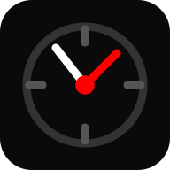
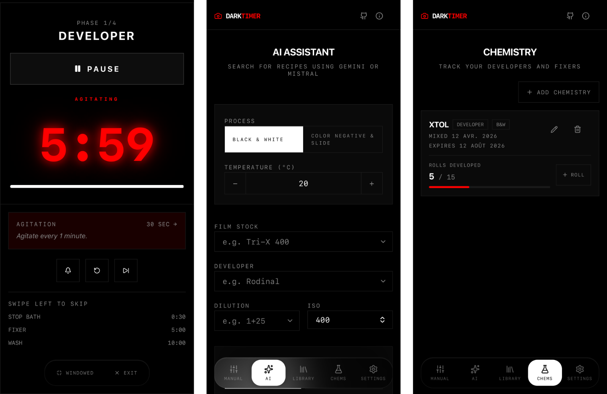

<div align="center">



# DarkTimer

**A darkroom timer for developing film at home.**

Build or look up a recipe, then run a guided multi-phase timer with agitation cues.
Installable, offline, and private: everything stays on your device.

[**Open DarkTimer →**](https://darktimer.vercel.app)

[](LICENSE)


<br />



</div>

## Features

| | |
|---|---|
| **Timer** | Multi-phase countdowns with agitation and phase-end cues by sound, screen flash, vibration, and notification. Keeps the screen awake, runs fullscreen, and resumes an interrupted session. |
| **Safelight theme** | Switches the whole interface to deep red on black, from the header or the timer controls. |
| **Recipes** | Build one by hand, search the built-in development chart, or ask Gemini or Mistral with your own API key. |
| **Library** | Save presets, and review every past session with the exact recipe that was run. |
| **Roll notes** | Rate the negatives from each session (thin, good, dense), add notes, and re-run or save the recipe. |
| **Chemistry** | Track developer and fixer batches by mix date, expiry, capacity, and roll count, with optional reuse compensation. |
| **Backup** | Export presets, history, chemistry, and settings to a JSON file and restore them on another device. |

## The timer

DarkTimer runs any sequence of phases, such as Developer, Stop Bath, Fixer, Blix, and Wash.

- **Agitation** every 60 seconds, every 30 seconds, or stand, changeable mid-phase
- **Cues you can tell apart in the dark:** a 440 Hz beep and a short double pulse for agitation, an 880 Hz beep and one long pulse for phase end
- **Pre-start countdown** of 0, 5, or 10 seconds before each phase
- **Yolo Run** to move through every phase automatically
- **Controls** for start and pause, reset phase, skip phase (or swipe left), and mute
- **Developer compensation** from a custom percentage or a matching chemistry record

Beeps are scheduled ahead on the audio clock, so they stay on time even when the browser slows its timers down. Wake lock, vibration, fullscreen, and notifications depend on the browser; DarkTimer carries on without whichever is missing.

## Recipes

**Manual builder.** Create black and white or colour (negative and slide) recipes with film, developer, dilution, ISO, temperature, phase durations, and agitation. Start one straight away or save it as a preset.

**Lookup.** The assistant checks the built-in development chart and your local cache first, and only then makes a live AI request. Gemini and Mistral are optional and use an API key you supply in Settings.

> [!WARNING]
> Chart and AI times are starting points, not authoritative processing instructions. Check anything that matters against the current datasheets from the film and chemistry manufacturers.

## Privacy and offline use

DarkTimer has no account and no backend. Recipes, settings, chemistry, history, and cached lookups live in IndexedDB on your device.

- **API keys** go straight from your browser to the provider you chose. Keep them for the current session only, or save them in a local vault encrypted with a passphrase.
- **Backups** never contain API keys.
- **Offline**, everything works except a new live AI lookup. The built-in chart and previously cached results remain available.

> [!NOTE]
> On iOS, Safari and the Home Screen app use separate storage. To move your data from one to the other, export a backup in Settings → History & Data and restore it on the other side.

## Install

DarkTimer runs in any modern browser, and installing it gives the most app-like timer.

| Platform | How |
|---|---|
| **iPhone, iPad** | Open the site in Safari, tap **Share → Add to Home Screen**, then launch it from the Home Screen. |
| **Android, desktop Chrome or Edge** | Use the browser's install button, or **Install DarkTimer** in its menu. |

## Development

Requires a current Node.js LTS release (22.12+ or 24). No API key is needed for manual recipes or the built-in chart.

```bash
npm install
npm run dev
```

The dev server runs at [localhost:3000](http://localhost:3000) and is reachable from other devices on your network, which is handy for testing on a phone.

| Command | What it does |
|---|---|
| `npm run dev` | Start the dev server |
| `npm run lint` | Type check with TypeScript |
| `npm run test` | Run the Vitest suite once |
| `npm run test:watch` | Run tests in watch mode |
| `npm run build` | Build the production PWA into `dist/` |
| `npm run preview` | Serve the production build locally |

### Project layout

```
src/
  components/   UI: timer, recipe builder, library, chemistry, settings, assistant
  hooks/        React hooks for stored data and the API key session
  services/     Storage (IndexedDB), backup, recipes, dev chart, AI providers, PWA
  lib/          Small utilities
```

### Stack

React 19 · Vite 8 · TypeScript · Tailwind CSS v4 · Motion · IndexedDB (`idb`) · Vitest · vite-plugin-pwa

DarkTimer is a web-only PWA deployed on Vercel. There is no native wrapper and no server component.

## License

MIT. See [LICENSE](LICENSE).
